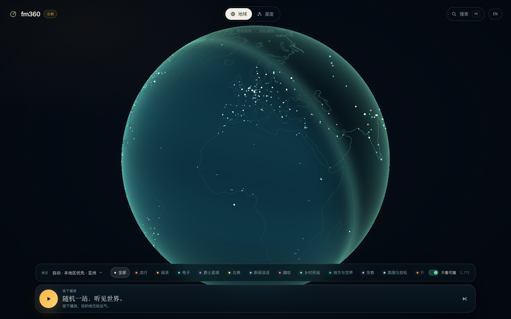
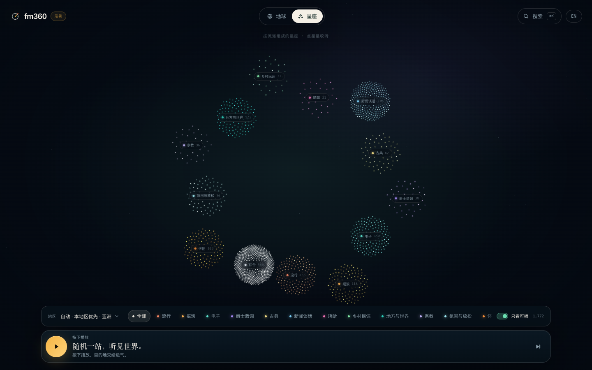

# fm360

**Listen somewhere new.** 随机一站，听见世界。

一个跑在 Cloudflare 免费额度上的世界电台 Web 应用。电台目录来自社区维护的 [Radio Browser](https://www.radio-browser.info/)，音频直连各电台自己的服务器。

当前是 **M0 视觉原型**：1,772 个真实电台、118 个国家/地区，先验证地球 / 星座 / 播放器 / 主题的气质，数据管线（Worker Cron）在 M1 接入。




## 现在能做什么

- **晨昏线地球**：按真实经纬度铺点，实时计算太阳方向；夜侧电台更亮，可拖拽旋转、滚轮/双指缩放。
- **流派星座**：一键切到按流派组成的星空，带星座连线、流派标签和数量。
- **随机收听**：按健康度、热度和地区权重随机选台；自动避开最近听过的台。
- **地区优先**：默认从浏览器时区推断本地区，70% 本地区 / 30% 全球；也可以严格筛选某个地区。
- **搜索**：名称、国家、语言、标签、流派本地搜索，按相关度排序；`⌘K` / `/` 打开。
- **筛选**：流派、地区、只看可播。
- **播放器**：播放/暂停、下一站、收藏、复制分享链接、音量、睡眠定时、媒体键/锁屏（Media Session）。
- **多语言**：中文 / English 可切换；国家、语言名用 `Intl.DisplayNames`。
- **移动端**：390×844 下无横向溢出；底部筛选条 + 播放器，电台详情变成 bottom sheet。
- **主题**：目前只有「夜航 Night」一套；主题 token 和 WebGL uniform 已分离，后续加主题只需新增 `src/themes/*.ts`。

> 目前是示例数据（`public/seed.json`），所有台只保留 HTTPS 线路，健康状态显示为「示例」。M1 的 Worker Cron 会每天/每周探测并替换成线上数据。

## 运行

```bash
cd /Users/chenning/project/fm360
pnpm install
pnpm dev
```

打开 <http://127.0.0.1:5173/>。

生成/刷新 seed（可选，会从 Radio Browser 取热门 3,000 个台，过滤 HTTPS、去重、分类、算时区）：

```bash
pnpm seed
```

构建：

```bash
pnpm build
```

> 如果 `pnpm` 仍然卡在 “Verifying lockfile against supply-chain policies”，项目里的 `.npmrc` 已设置 `verify-deps-before-run=false`；也可以直接用 `./node_modules/.bin/vite`。

## 目录

```
src/
  app/App.tsx               # 页面状态、筛选、随机、播放编排
  globe/globeRenderer.ts    # WebGL 地球 / 晨昏线 / 星座 / 点选
  globe/GlobeCanvas.tsx     # React 包装
  player/usePlayer.ts       # 音频、HLS、故障切换、睡眠定时、Media Session
  components/               # 顶栏、筛选、播放器、详情、搜索、星座标签
  data/                     # 类型、流派、地区
  themes/night.ts           # 夜航主题 token + WebGL 颜色
  i18n/                     # 中/英词典
  utils.ts                  # 当地时间、搜索、收藏、分享
scripts/seed.mjs            # 本地 bootstrap 数据（不是生产管线）
worker/index.ts             # Cloudflare Worker 入口（目前只有 /api/health）
wrangler.toml               # Cloudflare Workers + Static Assets 配置
screenshots/                # 本次原型的截图
```

## 已验证

- `tsc --noEmit` 通过，`vite build` 通过。
- 搜索 “jazz” → 48 个结果，回车播放成功。
- France Inter（HLS）与 Classic Vinyl HD（MP3）在 headless Chrome 中实际播放：`readyState=4`、`currentTime` 递增、音量 0.8。
- WebGL 无 GL error；切星星座、筛选、语言切换、移动端布局均通过。
- 截图：`screenshots/intro.png`、`globe.png`、`sky.png`、`station.png`、`playing.png`、`mobile.png`、`mobile-station.png`。

## 下一步（M1）

- D1 / R2 schema、Worker Cron 状态机：catalog → probe → publish → cleanup。
- 全量 ~35k 台、每日增量探测、HTTPS 升级、健康分、故障切换线路、`/api/status`。
- 部署到 `fm360.toolora.stream`（`wrangler.toml` 已写好 custom domain；需要 Cloudflare 账号里有 `toolora.stream` zone）。
- 之后再加第二套主题、更多 UI 语言、ICY now-playing 代理、SEO SSR。
